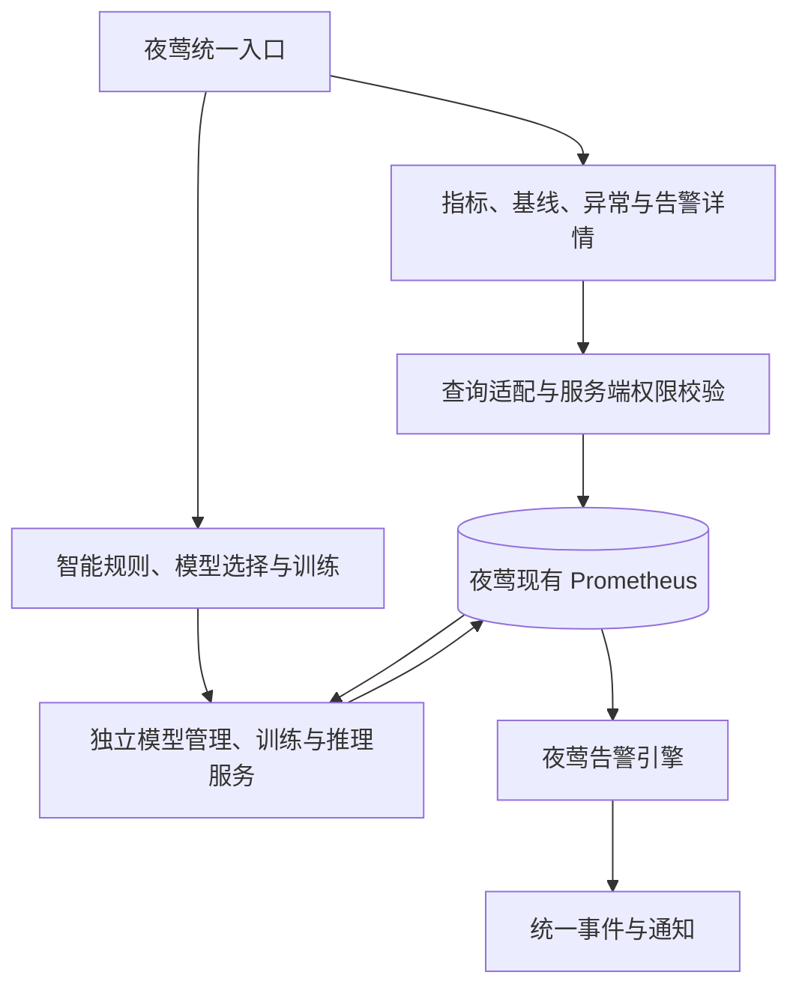

# 夜莺智能检测插件化与统一可视化备选方案

版本：v1.0  
状态：备选，当前不实施  
整理日期：2026-11-11  
关联：[主技术方案](夜莺规则与机器学习异常检测技术方案.md)

## 1. 决策与适用范围

**当前选定路线：建设独立的机器学习异常检测系统，使用独立 Web 页面，复用夜莺现有 Prometheus 中的时序数据。**

本文件保存后续将系统集成到夜莺内的备选方案。当前不开发夜莺插件、不改造夜莺前端、不要求通过嵌入页面统一入口；将来出现明确统一入口需求时再评估启用。

需要区分三个独立维度：

| 维度 | 当前路线 | 备选路线 |
|---|---|---|
| 使用入口 | 独立 Web 系统 | 夜莺菜单与检测页面 |
| 模型计算 | 独立训练、推理与管理服务 | 继续独立部署，供夜莺扩展页面调用 |
| 时序数据 | 复用夜莺当前配置的 Prometheus | 继续复用同一数据源 |

独立系统不等于必须另建一份原始时序存储；统一可视化也不要求把模型代码放进夜莺进程。告警对接仍可沿用主方案中的 Prometheus 结果指标与夜莺规则路线，与是否嵌入页面分别推进。

本文是此前方案的归档与路线记录，不表示插件或原生统一可视化已经完成。

## 2. 可用扩展基础及边界

### 2.1 嵌入产品入口

前期核查的 v9.3.0 源码和 API 说明包含 `embedded-product` 管理能力，用于将第三方页面链接加入夜莺首页和侧边栏，并控制入口可见性。

这可以作为统一入口的基础，但仅凭后端入口接口不能保证当前安装前端具有 iframe、共享时间范围或统一图表联动能力；需要匹配实际前端构建版本验证。入口权限也不等于外部服务已经具备数据和任务权限。

### 2.2 前端扩展

夜莺有独立开源前端仓库，可构建部署。因此可以在匹配版本上增加智能检测路由、菜单和业务页面。

此方式属于受控的前端扩展和二次开发。当前未核实存在可直接上传安装、热加载完整时序机器学习功能的通用插件 SDK；不能以 Grafana 式热插拔插件作为已知前提。前端仓库的构建插件也不能等同业务模型插件。

### 2.3 三种可选集成层次

| 层次 | 内容 | 局限 |
|---|---|---|
| 原生仪表盘 | 查询原始指标、预测值、上下界、分数和阈值 | 异常点、事件标记及波动带能力需核验 |
| 嵌入产品入口 | 从夜莺进入独立智能检测页面 | 是入口整合；展示方式和鉴权仍需适配 |
| 原生前端扩展模块 | 集成菜单、时间范围、实体选择、训练与告警详情 | 需维护前端改造及升级兼容性 |

若启用本备选方案，建议先统一基础数据展示，再按需求扩展原生页面，不强制将模型计算合并到夜莺后端。

## 3. 备选架构



用户在夜莺完成主要操作；模型服务独立部署，避免训练占用资源或推理故障阻塞夜莺普通规则评估。训练任务、模型文件、版本和人工反馈由模型管理服务保存。

建议交付组成：夜莺前端扩展、智能检测后端服务、仪表盘与规则模板、固定版本的配置和升级检查。不是当前已存在的官方插件包。

## 4. 统一可视化设计

### 4.1 数据分工

| 内容 | 查询来源 |
|---|---|
| 实际 QPS、延迟、CPU 等 | 现有 Prometheus 原始或聚合指标 |
| 预期值、参考上下界 | 模型输出指标，算法支持时提供 |
| 分数、阈值、质量和新鲜度 | 模型输出指标 |
| 夜莺触发与恢复事件 | 夜莺事件 API |
| 训练进度、模型版本、回放结果 | 模型管理服务 API |

拟采用 `n9e_ml_expected`、`n9e_ml_lower`、`n9e_ml_upper`、`n9e_ml_score`、`n9e_ml_threshold` 和 `n9e_ml_result_valid` 等指标。当前 Demo 使用 `ml_demo_*`，且尚未导出基线上下界 gauge。

图表实现先验证夜莺原生面板能力；对于波动带、异常标记、事件覆盖等原生组件未满足的部分，再新增专用页面或组件，不能假设导入模板即可实现所有效果。

### 4.2 对齐与历史语义

- 原始指标和模型结果共用实体定义、时间范围、采样间隔与业务时区。
- 使用源数据时间对齐结果，不能用推理完成时间替代观测时间。
- 明确预测目标时刻与观测时刻，避免将未来预测画在错误位置。
- 保存当时在线结果，回放使用的新模型版本需单独标识，不能无提示改写历史检测结论。
- 缺失、过期、训练未完成和模型失效明确展示，不补造正常值。
- 多指标模型不一定提供预测上下界，按算法能力展示。

## 5. 页面与权限集成

拟增加以下功能入口：

```text
夜莺
├── 指标查询与仪表盘
├── 告警管理
└── 智能检测
    ├── 智能规则
    ├── 在线检测详情
    ├── 训练任务
    ├── 模型版本
    └── 历史回放
```

检测详情页统一呈现实测曲线、预测或参考范围、分数、阈值、异常点、数据新鲜度和对应的夜莺事件；用户可选择模型、发起异步训练、查看回放、发布回滚和提交反馈。

权限集成至少处理：

1. 页面入口、任务、模型和数据查询分别授权。
2. 服务端校验业务组或明确的授权范围，不把隐藏按钮当成鉴权。
3. 用户身份通过经过验证的网关或认证适配传递，不能仅因同域部署就假定自动获得夜莺权限。
4. 统一登录、退出、无权限响应和审计关联需实际验收。
5. 时间选择、实体选择、刷新行为与夜莺页面保持一致。

可使用同域路由分别代理夜莺与模型服务，但同域路由、身份认证和权限校验是不同职责。不得为页面整合而绕过认证。

## 6. 演进步骤与启用条件

当前不启动下列改造，仅保留演进路径：

| 步骤 | 内容 | 验收要点 |
|---|---|---|
| 1 | 模型输出标准化，导出基线及上下界 | 实体、时间和版本可追溯 |
| 2 | 夜莺基础仪表盘及检测详情关联 | 同一查询口径、时间窗和筛选项 |
| 3 | 核验并接入嵌入产品入口，或新增原生路由 | 不跳错地址，认证和权限正确 |
| 4 | 原生智能检测页面及任务流程 | 选模型、训练、发布和告警关联完整 |
| 5 | 固定前后端版本、回归与升级验证 | 升级不破坏任务、页面和事件身份 |

启用条件：明确需要在夜莺内完成主要操作；独立系统的任务、模型、查询和告警接口已经稳定；具备匹配版本前端及持续维护能力。页面统一不能替代主方案中的训练评估、未知状态处理和告警恢复验收。

## 7. 当前独立系统的兼容约定

当前开发应遵循以下边界，为将来集成保留能力而不提前实施插件化：

- 独立 Web 页面完成数据选择、模型选择或训练、在线检测和历史回放。
- 直接通过现有 Prometheus 查询接口读取数据；“夜莺的数据”在当前架构中指夜莺使用的时序数据源，不是抓取夜莺网页或读取其告警数据库作为时序输入。
- 固定数据源和查询口径，不另行建设重复的原始采集链路。训练快照、模型制品和元数据可以独立保存并记录出处。
- 前端与后端分离，任务、模型、历史结果和告警关联采用稳定标识。
- 原始数据、模型结果及质量时间戳规范化，避免未来集成时迁移全部数据协议。
- 当前不要求复用夜莺登录，也不自动继承夜莺权限；独立服务的访问范围和权限应按实际部署设计。
- 继续保留与夜莺告警系统对接的接口边界，不将“界面独立”解释成必须重建一套通知系统。

当前路线下，基础形态为：

```text
独立 Web → 独立管理/查询 API → 夜莺现有 Prometheus
                         ↓
                  模型训练与在线推理
                         ↓
                 结果展示及告警对接
```

## 8. 参考资料

- [主技术方案](夜莺规则与机器学习异常检测技术方案.md)
- [既有调研报告](<../modules/devices/nvidia-gpu/ml/reports/夜莺 机器学习 自定义模型 调研.md>)
- [当前Demo说明](../modules/devices/nvidia-gpu/ml/demo/README.md)
- [v9.3.0嵌入产品API说明](https://github.com/ccfos/nightingale/blob/v9.3.0/doc/api/embedded-product.md)
- [v9.3.0嵌入产品处理源码](https://github.com/ccfos/nightingale/blob/v9.3.0/center/router/router_embedded.go)
- [夜莺前端仓库](https://github.com/n9e/fe)
- [前端嵌入产品目录，main分支参考](https://github.com/n9e/fe/tree/main/src/pages/embeddedProduct)
- [v9.3.0前端构建脚本](https://github.com/ccfos/nightingale/blob/v9.3.0/fe.sh)

上述前端 main 分支资料只用于说明扩展基础，不代表当前安装版本已经具备完全一致的页面行为。采用备选方案前应重新核验实际前后端构建版本及接口兼容性。
