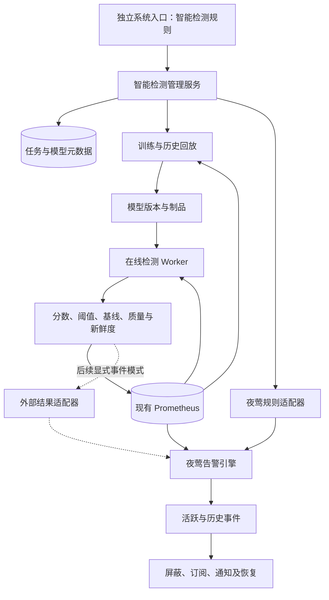

# 夜莺规则与机器学习异常检测技术方案

版本：v1.1  
整理日期：2026-11-11  
适用基线：当前项目的开源夜莺 Nightingale v9.3.0、现有 Prometheus 和异常检测 Demo  
文档性质：前期调研与工程方案汇总；本次保存文档不代表执行后续开发或修改运行配置。

> **当前选定路线（2026-11-11）：独立系统 + 夜莺现有数据源。** 使用独立 Web 页面建设模型选择、训练、检测与可视化，通过 Prometheus API 读取夜莺现有时序数据。插件化、嵌入页面及夜莺原生前端改造均作为备选，当前不实施；详见[统一可视化备选方案](夜莺智能检测插件化与统一可视化备选方案.md)。独立界面不取消后续与夜莺告警系统对接的设计。

> **GPU专项实施入口：** 后续新增功能按[GPU机器学习监控模块](../modules/devices/nvidia-gpu/ml/README.md)的需求、技术方案与项目计划推进。该模块复用既有GPU台账和规则，使用独立页面；其生产源只读、GPU恢复语义及结果网关等专项决策以模块文档为准。本文件保留通用调研和早期原型背景。

## 1. 文档范围与结论

本方案面向运维监控场景，在保留固定规则、可用性和 SLO 告警的基础上，引入时序机器学习，补充周期偏离、指标关系异常、渐进漂移等检测能力。

当前目标是建设独立的异常检测系统：用户在独立页面选择夜莺现有 Prometheus 中的指标、选择已有模型或训练新模型，查看训练和检测效果；后续告警对接可复用夜莺的业务组、告警事件、屏蔽、通知和恢复机制。接近官方插件的夜莺内统一入口作为备选演进目标。

核心结论：

1. 官方有商业智能检测插件，可以与开源夜莺集成；但公开资料尚未证实它提供通用的自训练模型权重上传、算法 SDK 或第三方推理服务注册接口。
2. 在已核查的开源 v9.3.0 评估与数据源路径中，没有发现通用模型训练、上传和执行平台。不能将源码中的 `AnomalyPoint` 或官网的大语言模型“模型自选”视为自定义时序模型支持。
3. 自研方案可行：新增独立的智能检测管理服务、训练与推理 Worker、模型版本管理及页面，复用现有 Prometheus 和夜莺告警系统。
4. 首期优先采用“模型输出指标 → Prometheus → 夜莺普通 PromQL 规则”；对严格的未知状态保持及显式恢复要求，再适配外部结果接口。
5. 目标方案同时支持选择内置算法、复用已发布模型、训练新模型和注册自定义模型。当前 Demo 只完成其中的固定算法训练与在线检测，不等于完整模型平台已交付。

统计异常不一定是故障，故障也不一定偏离历史模式。机器学习应补充规则，不能成为所有关键硬规则的前置确认条件。

## 2. 当前环境与完成范围

### 2.1 环境基线

| 项目 | 当前情况 |
|---|---|
| 夜莺 | Compose 配置使用 `flashcatcloud/nightingale:9.3.0` |
| Prometheus | Compose 配置使用 `prom/prometheus:v3.2.1`，容器内地址 `http://prometheus:9090` |
| 夜莺本地入口 | `http://localhost:17000` |
| Prometheus 本地入口 | `http://localhost:19090` |
| ML Demo 本地入口 | `http://localhost:19450` |
| Prometheus 保留期 | 当前 Compose 配置为 3 天 |
| Demo 采集 | `ml-anomaly-demo` job，2 秒抓取 |

以上是配置与既有验收基线，不是本次保存文档时重新执行的运行状态检查。端口仅绑定宿主机本地地址；远程浏览需使用已有转发方式。

### 2.2 已完成与待实现

| 能力 | 当前状态 |
|---|---|
| 模拟 QPS、延迟、CPU 指标 | 已实现，三个服务 |
| 现有 Prometheus 实际采集和存储 | 已实现并验收 |
| 开源模型训练和在线推理 | 已实现，启动时用独立健康模拟数据训练 |
| 基线、异常点、分数和事件回放页面 | 已实现为独立 Web 页面 |
| 四种故障注入及恢复 | 已通过在线链路验收 |
| 模型输出再次由 Prometheus 采集 | 已通过验收 |
| 夜莺原生 ML 告警规则与通知闭环 | 尚未配置和验收 |
| 夜莺原生智能规则页面及仪表盘 | 尚未实现；插件化与原生页面整合为备选，当前不实施 |
| 从真实业务历史训练、自动重训练 | 尚未实现 |
| 模型库、用户模型注册、灰度回滚 | 尚未实现 |
| 外部结果接口接入及显式恢复 | 已核查源码，尚未进行接口写入验证 |
| 浏览器视觉和点击验收 | 浏览器服务不可用，尚未完成；已检查 HTTP、HTML 结构和 JS 语法 |

当前 Demo 的 Web 事件表是模型回放结果，不是夜莺活跃或历史告警表；其基线通过页面 API 返回，尚未导出为 Prometheus 上下界指标。

## 3. 夜莺能力调研

### 3.1 官方商业能力

官方独立产品页描述了时序趋势学习、动态检测、训练效果反馈以及与开源夜莺集成并复用事件处理的能力。专业版页面还说明可单独购买智能告警插件，因此不能简单理解为必须整体升级专业版才能引入官方算法。

公开资料支持“使用厂商的检测服务”，但尚不足以证明“可上传任意 sklearn、PyTorch、ONNX 模型或注册自己的算法”。插件与当前 9.3.0 的兼容版本、支持算法、私有化部署资源和自定义模型契约仍需厂商确认。

官网 AI Agent、摘要、PromQL 生成等语境中的“模型自选”指大语言模型，不能混同于时序异常检测模型扩展。

来源：[官方智能检测插件](https://flashcat.cloud/product/flashcat-aiops-alert/)、[专业版说明](https://flashcat.cloud/product/flashcat-pro/)、[官方检测介绍](https://flashcat.cloud/blog/n9e-support-anomaly-detection/)、[官网](https://n9e.io/zh/)。

### 3.2 开源 v9.3.0 的职责

`GetPromAnomalyPoint` 主要执行 PromQL 并将结果转换成异常点，随后进入事件处理流程。本次已核查评估、数据源及相关接入代码，未发现通用模型上传、训练注册和任意 HTTP 推理的正式 SDK。这是有范围的源码核查结论，不是对所有版本或商业代码的绝对判断。

夜莺的原生职责可继续复用：规则配置、周期查询、持续时长判断、事件持久化、通知规则和相关事件处理。

来源：[v9.3.0 评估源码](https://github.com/ccfos/nightingale/blob/v9.3.0/alert/eval/eval.go)、[夜莺告警流程](https://flashcat.cloud/docs/content/flashcat-monitor/nightingale-v9/usecase/alerting/)。

### 3.3 外部结果接入口

v9.3.0 存在 `/v1/n9e/event`、`/event-persist`、`/make-event`，受 `HTTP.APIForService` 控制，官方默认关闭。它们是事件或结果接入口，不是模型训练和推理接口。

其中 `/make-event` 接收包含 `alert`、`vectors`、`rule_id`、`datasource_id`、`inhibit` 的数组，依赖已存在的匹配外部规则处理器，分别执行异常处理或显式恢复。不能直接拿普通 Prometheus 规则 ID 就假设可调用成功。`/event-persist` 主要负责持久化，也不能替代完整告警生命周期。

来源：[路由](https://github.com/ccfos/nightingale/blob/v9.3.0/alert/router/router.go)、[处理逻辑](https://github.com/ccfos/nightingale/blob/v9.3.0/alert/router/router_event.go)、[调度逻辑](https://github.com/ccfos/nightingale/blob/v9.3.0/alert/eval/alert_rule.go)、[默认配置](https://github.com/ccfos/nightingale/blob/v9.3.0/etc/config.toml)。

通知 Webhook、AI 事件摘要、Ibex 自愈和通知脚本属于其他扩展环节，不能作为模型检测入口的替代说明。本文不假设商业插件采用与自研方案完全相同的内部实现。

## 4. 总体架构与职责



| 模块 | 职责 | 建议实现 |
|---|---|---|
| 数据适配器 | PromQL/SQL 查询、重采样、质量检查、实体对齐 | 独立 Python 模块，训练和推理共用 |
| 管理服务 | 任务配置、权限、训练调度、规则关联和模型发布 | 初期单服务，后续按任务量拆分 |
| 训练 Worker | 特征生成、训练、校准、回放评估 | CPU 优先，深度模型按需分配 GPU |
| 推理 Worker | 增量查询、因果特征、模型评分、输出结果 | 定时微批；不嵌入夜莺评估协程 |
| 模型注册库 | 模型制品、版本、预处理、阈值及出处 | 初期数据库加持久卷，扩展后对象存储 |
| 规则适配器 | 将智能任务同步为夜莺规则并维护映射 | 固定版本 API 适配 |
| 夜莺 | 统一告警事件与通知管理 | 复用现有系统 |
| 页面 | 智能任务、训练效果、回放、版本和反馈 | 当前独立 Web；夜莺内页面整合仅为备选 |

首期不必立即引入 Kafka、Flink、独立特征平台或大型模型服务框架。先按目标实体数、查询成本和延迟预算压测，再决定是否增加流式管道。

## 5. 数据接入与预处理

当前“使用夜莺的数据”指复用夜莺已配置的 Prometheus 时序数据源，通过查询 API 获取指标，不抓取夜莺网页，也不将其告警数据库当作时序存储。独立系统直接读取同源指标，不另建重复原始采集链路；训练快照、模型文件和任务元数据可独立持久化并记录数据出处。

### 5.1 Prometheus

历史查询使用 `/api/v1/query_range`，按指标组和时间窗口分批获取；在线推理只读取增量及必要的历史上下文。常用聚合表达式可通过 recording rules 减少重复计算。

指标处理应遵守语义：

- Counter 先使用 `rate` 或 `increase`，不直接对累计值检测波动。
- Histogram 按分布或桶计算目标分位数，不直接平均各实例 P99。
- 错误率先聚合错误数和请求数，再计算比值。
- 优先按服务、集群等稳定实体聚合，控制标签基数。
- 范围查询可能重复返回 lookback 旧值，需检查源数据时间，重复旧样本不能推进持续性状态机。

**当前 Prometheus 只保留 3 天数据，无法直接提供 14 天或数周的训练历史。** 接真实业务前需要规划保留期、长期存储或周期导出数据集，并验证容量；本方案不自动修改当前保留期。

### 5.2 ClickHouse

后续可通过 `clickhouse-connect` 增加 SQL 适配器，将查询结果转换为相同的模型输入结构。聚合方式需按指标定义选择末值、均值、最大值、速率或可合并分布，不能统一取平均。

若两个系统均有数据，应为每个任务明确权威数据源，并固定训练与在线的查询口径。

### 5.3 统一逻辑结构与质量要求

```text
source_timestamp | entity_id | metric_name | labels | value | quality_flag
```

内部统一 UTC，日历特征按业务时区生成；进行去重、乱序处理、采样对齐和缺失标记。短缺口仅按指标语义填补，长缺口进入未知状态，不能默认补零。

多指标模型只能组合同一实体、同一时间桶的指标。训练与推理共用特征代码及版本；只能使用推理当时已获得的数据，不能使用中心窗口或未来插值。

## 6. 算法选型与模型使用方式

### 6.1 按异常类型选模型

| 异常类型 | 例子 | 首选方法 |
|---|---|---|
| 瞬时尖峰或骤降 | 延迟突增、QPS 突降 | 稳健统计、周期残差与单指标森林 |
| 周期偏离 | 工作日上午流量明显低于往常 | 同周期基线、预测残差 |
| 持续漂移 | CPU 或延迟逐步恶化 | 趋势或变化点检测 |
| 多指标关系异常 | 请求量不变而延迟、资源升高 | 联合残差特征与 Isolation Forest |
| 异常波形 | 新出现的周期振荡 | STUMPY Matrix Profile，按需评估深度模型 |
| 数据中断 | 采集失联或输入缺失 | 独立数据质量检测 |

首期组合：周期基线或 Ridge 预测，加联合与单指标 Isolation Forest。预测需求可对照 MLForecast；波形需求对照 STUMPY；Chronos 等预训练预测模型作为实验候选，不直接视为开箱即用的运维告警系统。

PyOD 可用于算法对照。Merlion 官方仓库在前期调研时已显示归档，新项目选为核心依赖需明确维护责任。

### 6.2 四种模型使用方式

| 方式 | 含义 | 是否训练 | 目标状态 |
|---|---|---|---|
| 选择内置算法 | 选择森林、基线等，用任务自己的历史数据建立模型 | 通常需要 | 规划支持 |
| 选择已发布模型 | 从模型库选已有版本执行推理 | 不必重新训练，仍需验证适配性和阈值 | 规划支持 |
| 训练新模型 | 指定指标、训练窗口、参数，训练和校准后发布 | 需要 | 规划支持 |
| 注册自定义模型 | 封装自己的算法或推理服务，接入统一协议 | 取决于模型 | 规划支持 |

“开源算法”和“自己训练”不是二选一。使用 scikit-learn 的 Isolation Forest 在自己的数据上执行训练，就是训练自己的模型。一个服务训练的模型也不能不经验证就套用到所有服务。

当前 Demo 使用固定算法、模拟健康数据和启动时训练，尚无用户选择模型、真实业务训练和模型库功能。

### 6.3 自定义模型协议

以下为拟实现的内部协议，并非夜莺已有 SDK：

```text
fit(training_data, config) -> model_artifact
calibrate(model_artifact, validation_data) -> threshold_policy
predict(model_artifact, causal_window) -> detection_result
```

结果至少包含分数、有效性、源数据时间、模型版本；按算法能力可包含预期值、上下界和贡献指标。多指标森林不天然产生预测上下界，也不能把“最大标准化残差指标”当成精确的模型因果解释。

制品应保存输入结构、预处理与特征版本、依赖、训练数据范围、校准策略和适用实体。未知周期的真实数据不能直接沿用 Demo 已知的 120 秒、360 秒周期。

## 7. 训练评估与模型生命周期

### 7.1 训练流程

```text
选择指标与实体 → 数据质量检查 → 标记已知故障与维护
→ 按时间切分训练/校准/测试 → 特征生成 → 训练
→ 阈值校准 → 滚动历史回放 → 影子运行 → 灰度发布
```

无标签时优先采用以正常数据为主的无监督训练；逐步积累真实故障、正常业务变化、发布和采集问题标签。历史规则告警不是可靠的真实故障标签。

周期指标需要覆盖多个完整业务周期；涉及周周期时可争取 8～12 周历史作为起点，但应结合可用数据和业务变化调整。训练、校准、测试按时间切分，不随机打乱；归一化、基线和滑动特征不能泄漏未来信息。

### 7.2 阈值和效果评估

异常分数不是故障概率。阈值在独立校准窗口上确定，根据每服务误报预算、故障召回和发现延迟调节，不能把 `contamination` 直接当作真实故障率。

以事件为主要评估单位：

- 告警准确率、故障召回率、发现延迟。
- 每服务每日误报事件数及值班负担。
- 相比现有规则新增发现的故障。
- 查询、训练、推理和时序存储成本。

不只看点级准确率或预测误差，也不因命中一个故障点就将整段事件全部算作检测成功。模拟注入测试不构成真实生产准确率承诺。

### 7.3 模型与任务状态

模型状态建议为 `draft → training → calibrated → validated → published → retired`；任务另有启用、暂停、降级和失败状态。模型版本与稳定检测任务 ID 分离，版本更新不应直接改变告警实体身份。

重训练先离线回放和影子对比，合格后灰度替换，保留回滚版本。不要在持续故障中无条件更新基线，把故障学成正常。需要区分历史在线结果和使用新模型重新计算的回放结果。

## 8. 智能规则管理与夜莺告警对接

### 8.1 用户配置与自动规则映射

用户只维护一条智能任务，后台自动维护对应夜莺规则。以下为自研配置示意，不是夜莺原生格式：

```yaml
name: checkout 延迟异常
business_group: application
input_datasource: current-prometheus
queries:
  latency: '<延迟 PromQL>'
  qps: '<QPS PromQL>'
entity_labels: [cluster, service]
model_mode: train_new
algorithm: seasonal_isolation_forest
training_window: 14d
evaluation_interval: 30s
sensitivity: medium
notification_rule: application-oncall
event_backend: prometheus_rule
```

`14d` 是示意值，实际应先满足第 5 节的数据保留条件。选择已发布模型时使用模型版本引用，并校验输入和适用范围。

后台流程：

1. 校验数据源、PromQL、实体维度和业务组权限。
2. 分配稳定 `detector_id`，训练或加载模型，完成校准与回放。
3. 模型发布后启用 Worker，并建立对应夜莺规则。
4. 保存任务、模型版本、夜莺规则、数据源、业务组和通知规则之间的关联。
5. 定期对账同步状态；仅管理自己标记的规则，用户手工修改产生冲突时明确处理。

管理服务与夜莺 API 无法靠一个数据库事务保证原子性，需使用幂等操作、重试及对账机制。任务删除、暂停、模型失败和规则被手工禁用均需定义联动策略，避免留下孤立规则或重复任务。

### 8.2 推荐输出指标

以下为正式系统拟采用的指标名，当前 Demo 仍使用 `ml_demo_*`：

| 指标 | 说明 |
|---|---|
| `n9e_ml_score` | 校准前后定义明确的异常分数 |
| `n9e_ml_threshold` | 当前生效阈值 |
| `n9e_ml_result_valid` | 当前结果是否有效，0/1 |
| `n9e_ml_source_timestamp_seconds` | 本次结果所依据的有效源数据时间 |
| `n9e_ml_expected` | 可选，预期值 |
| `n9e_ml_lower` / `n9e_ml_upper` | 可选，预测或参考上下界 |
| `n9e_ml_task_info` | 有限的版本和任务说明元数据 |

核心标签建议为 `detector_id`、`cluster`、`service`，按需增加明确的实体键。输入输出实体维度必须匹配；不能把指标分数、异常原因自由文本、事件时间或每次训练 UUID 当作普通标签。

版本出处应保留在元数据和结果记录中，避免更换模型标签导致事件身份变化。复杂解释与反馈存入详情服务，不能依靠高基数标签承载。多 Worker 副本必须选主或去重，保证每个检测实体只有一个有效结果。

### 8.3 夜莺生成的 PromQL

以下示例假设各输出指标具有一致、唯一的匹配键：

```promql
(
  n9e_ml_score{detector_id="42"}
  >
  n9e_ml_threshold{detector_id="42"}
)
and on(detector_id,cluster,service)
(n9e_ml_result_valid{detector_id="42"} == 1)
and on(detector_id,cluster,service)
(time() - n9e_ml_source_timestamp_seconds{detector_id="42"} < 90)
```

90 秒仅针对假设的 30 秒检测周期举例，需根据采集、推理、入库和查询延迟确定。不要将比较改成 `> bool` 后直接用于告警，因为它可能保留值为零的正常序列。PromQL 的 `and` 判断序列存在性，不把零值自动当成 false。

夜莺规则关联已有业务组、严重级别和通知规则，产生原生告警事件；模型服务无需另建通知系统。当前项目已有固定 v9.3.0 的管理适配代码，可作为实现基础，但不能将现有模拟环境管理员导入方式直接作为生产权限设计。

### 8.4 普通规则与 ML 的组合

| 模式 | 策略 |
|---|---|
| 独立硬规则 | 可用性、容量、明确 SLO 等继续独立告警 |
| 独立 ML 规则 | 检测周期偏离、关系异常和漂移 |
| 软规则 AND ML | 在指定降噪场景要求业务条件与有效模型结果同时成立 |

同一故障被规则和模型同时发现时，按服务、实体和时间窗口设计聚合，保留检测来源。不要简单合并不同行为含义的原始模型分数；组合前需分别校准。

## 9. 触发恢复与故障语义

### 9.1 三态原则

| 状态 | 含义 | 行为 |
|---|---|---|
| 正常 | 新鲜且有效的数据表明恢复正常 | 可按恢复策略解除 |
| 异常 | 有效结果超过异常条件 | 触发或维持业务事件 |
| 未知 | 输入缺失、推理失败、模型未就绪 | 产生检测能力故障，不宣称业务恢复 |

持续性、滞回和恢复窗口必须有明确负责人。可由模型输出逐点评分、夜莺控制持续时长；若模型已做“最近五点三次异常”，夜莺再增加持续时长会叠加延迟。Demo 已使用 3/5 判断，不应无意重复等待。

### 9.2 指标模式的边界

新鲜度过滤能阻止旧结果继续触发，但过滤后的空结果不等于业务已恢复。夜莺默认规则恢复和无数据处理必须针对实际配置验收，不能只增加一条健康告警就声称彻底解决了错误恢复。

指标模式至少配置：模型服务不可用、任务推理过期、输入缺失或质量失败。预期任务/实体清单应由管理服务维护，因为仅查询已存在的指标不能发现所有从未上报或已经消失的实体。

### 9.3 严格恢复要求下的增强

若生产要求“检测中断时保持已有异常，只在新鲜正常证据满足恢复条件时解除”，增加持久化结果状态机及外部结果适配器：

- 保留异常、正常和未知状态，记录最后有效源时间与事件身份。
- 通过已核查的外部处理接口发送异常与显式恢复；需要适配外部规则处理器、数据源、路由与鉴权。
- 持久化待投递结果，支持重试、幂等、乱序拒绝、主实例切换与重启恢复。
- 业务告警和模型故障分别表达；模型故障期间不能补造正常结果。
- 同一任务只选择一个业务事件入口，禁止指标规则和直接推送同时创建重复业务事件。

Prometheus 仍保存分数、基线和质量历史，供看图与审计。外部接口模式在当前系统尚未启用和实测，须先完成小范围兼容性 PoC，不能仅凭源码存在就宣称生产可用。

## 10. Web页面与使用流程

目标流程：

```text
创建智能规则 → 选择指标与实体 → 选择已发布模型或训练新模型
→ 质量检查与历史回放 → 发布上线 → 夜莺统一告警 → 反馈与迭代
```

拟实现页面：

| 页面 | 内容 |
|---|---|
| 智能规则列表 | 业务组、任务状态、模型、训练进度、夜莺规则关联 |
| 创建与编辑 | 数据源、PromQL、实体、算法、训练窗口、敏感度和通知 |
| 训练详情 | 数据质量、训练状态、校准、回放事件及对照结果 |
| 在线检测详情 | 实际曲线、预期范围、分数、阈值、新鲜度和当前事件 |
| 模型版本 | 发布、灰度、回滚、适用范围和训练出处 |
| 故障反馈 | 真故障、正常业务变化、发布、采集问题和未确认 |

当前使用独立 Web 页面实现上述功能，不要求嵌入夜莺或修改其前端。独立服务的访问控制按实际部署设计，不能默认继承夜莺登录或业务组权限；如接入夜莺资源管理，需显式校验相关权限。训练任务异步执行，不阻塞告警评估。夜莺仪表盘、详情入口和原生“智能检测”页面参见备选方案，当前不实施插件化。

告警详情可展示任务、模型版本、实际偏差和检测页链接。事件后处理是否改变历史持久化内容需遵守夜莺流程，不能假设通知阶段追加的解释会自动回写历史事件。

## 11. 部署与工程可靠性

初期可将管理 API、调度和指标导出合并部署，训练与推理分别受控执行；元数据使用关系数据库，模型文件使用持久卷。任务增多后再拆分 Worker、增加对象存储和队列。

工程要求：

- 为任务定义评估截止时间、水位和允许迟到时间；重复旧样本不能推进状态。
- 推理必须携带源数据时间，不能只用“刚执行成功”的墙钟时间掩盖旧输入。
- 训练和线上使用相同的查询、特征与预处理版本。
- 任务调度有租约或分片机制，避免多实例重复评估和重复输出。
- 模型发布、规则同步和暂停操作可审计、可重试、可对账。
- 版本切换不能无条件清空活跃告警，切换与回滚均需验证事件身份。
- 权限按业务组隔离，管理凭证按服务需要配置；模型执行依赖使用固定版本。
- 监控查询耗时、输入新鲜度、训练失败率、推理耗时、告警数量和规则同步失败。

规模估算应同时考虑：实体数、每实体输入指标数、采样频率、模型成本及派生序列数。若 N 个实体每个输出 K 条数值序列，新增规模约为 N×K，再叠加版本和维度变化；不能按单个任务的模型大小估算整个系统成本。

## 12. 分阶段实施与验收

| 阶段 | 交付 | 验收标准 |
|---|---|---|
| 第一阶段：独立系统与告警闭环 | 独立页面读取同源指标、模型结果与健康规则、按计划对接夜莺测试通知 | 独立页面检测链路可用；告警对接时验证夜莺事件、通知、恢复及中断语义 |
| 第二阶段：智能任务管理 | 配置页面、异步训练、模型发布、规则自动同步 | 无需手写模型结果 PromQL，可选已有模型或训练新模型 |
| 第三阶段：生产可靠性 | 持久状态、幂等对账、权限、灰度回滚；按需外部事件模式 | 重启、断数、重复结果和版本切换不会错误恢复或重复触发 |
| 第四阶段：真实业务验证 | 真实历史数据、反馈标签、模型对照与影子运行 | 在约定误报预算下取得可量化增量收益 |

真实业务数据准备可与第一、二阶段并行，不必等平台全部完成后才开始。具体工期需根据夜莺前端改造范围、实体规模和恢复要求细化，不在本文件中承诺固定周期。

必测场景：正常运行；四类注入；短缺口与长缺口；查询失败；Worker 停滞；指标导出器停止；任务暂停；模型切换和回滚；重复投递；规则手工修改；触发与恢复通知配对。

关键验收边界：固定规则不受模型故障阻断；未知不被声称为业务正常；训练回放收益与生产收益分别报告；Demo 事件与夜莺原生事件分别核对。

## 13. 当前Demo运行说明

### 13.1 入口与命令

页面：`http://localhost:19450`。

在项目根目录执行：

```bash
bash modules/devices/nvidia-gpu/ml/scripts/anomaly-demo.sh up
bash modules/devices/nvidia-gpu/ml/scripts/anomaly-demo.sh test
bash modules/devices/nvidia-gpu/ml/scripts/anomaly-demo.sh verify
```

`up` 构建新增服务，校验 Prometheus 配置后热加载新增 job。`verify` 会临时改变 checkout 模拟场景，验证四类注入和恢复，最后恢复自动轮播；它不是生产只读巡检。

### 13.2 当前模型

scikit-learn 1.6.1；每个服务采用 Ridge 周期基线、一个联合森林和三个单指标森林，每个森林 160 棵树。每服务使用 3,600 个健康模拟点训练、后续独立窗口 1,200 个点校准。联合特征包括残差、差分、后向均值和关系；单指标森林使用绝对标准化残差。

单个联合森林在初始测试中对单维持续偏离存在漏检，最终组合加入单指标森林，并对组合分数重新校准。这是本 Demo 的测试驱动调整，不代表所有生产任务都需要相同组合。

各森林分数先按校准分位数归一，取最大比值，再用独立健康校准窗口组合分数的 99.5% 分位数确定阈值。分数不是故障概率，也不是线性故障严重度。

### 13.3 已保存的验收结果

| 场景 | 在线触发耗时 | 结果 |
|---|---|---|
| 延迟尖峰 | 8.01 秒 | 通过，恢复通过 |
| 流量骤降 | 8.01 秒 | 通过，恢复通过 |
| CPU 漂移 | 10.02 秒 | 通过，恢复通过 |
| 指标关系异常 | 8.01 秒 | 通过，恢复通过 |

五项单元测试通过，覆盖正常回放误报预算、四类异常、未来数据泄漏、lookback 重复样本和缺失数据；三服务模型输出已由同一个 Prometheus 采集。这些结果证明 Demo 链路，不证明真实故障准确率，也不代表夜莺原生告警闭环已验收。

当前可用于后续配置夜莺规则的表达式：

```promql
(ml_demo_alert_active{job="ml-anomaly-demo"} == 1)
and on(job,instance,service)
(time() - ml_demo_last_success_timestamp_seconds{job="ml-anomaly-demo"} < 10)
```

十秒门限仅用于当前 Demo；仍须遵守第 9 节的未知与恢复边界。

### 13.4 项目文件

- [Demo说明](../modules/devices/nvidia-gpu/ml/demo/README.md)
- [模型实现](../modules/devices/nvidia-gpu/ml/demo/model.py)
- [服务与数据链路](../modules/devices/nvidia-gpu/ml/demo/app.py)
- [Web页面](../modules/devices/nvidia-gpu/ml/demo/index.html)
- [启动脚本](../modules/devices/nvidia-gpu/ml/scripts/anomaly-demo.sh)
- [Compose配置](../deploy/nvidia-gpu/lab/compose.yaml)
- [Prometheus采集配置](../deploy/nvidia-gpu/lab/prometheus/prometheus.yml)
- [验收结果](../modules/devices/nvidia-gpu/ml/evidence/anomaly/acceptance.json)
- [既有夜莺管理适配器](../modules/devices/nvidia-gpu/rules/lab/n9e.py)

## 14. 参考资料

### 14.1 已有项目调研

- [夜莺机器学习与自定义模型调研报告](<../modules/devices/nvidia-gpu/ml/reports/夜莺 机器学习 自定义模型 调研.md>)
- [产品能力研究笔记](<../modules/devices/nvidia-gpu/ml/research_notes/夜莺 机器学习 自定义模型 调研/product.md>)
- [源码扩展研究笔记](<../modules/devices/nvidia-gpu/ml/research_notes/夜莺 机器学习 自定义模型 调研/source.md>)
- [集成方案研究笔记](<../modules/devices/nvidia-gpu/ml/research_notes/夜莺 机器学习 自定义模型 调研/integration.md>)

### 14.2 官方资料

- [夜莺智能检测插件](https://flashcat.cloud/product/flashcat-aiops-alert/)
- [夜莺专业版](https://flashcat.cloud/product/flashcat-pro/)
- [官方异常检测介绍](https://flashcat.cloud/blog/n9e-support-anomaly-detection/)
- [历史专业版能力说明](https://flashcat.cloud/docs/content/flashcat-monitor/n9e-pro/highlights/)：仅作历史背景，不能整体推导当前版本边界。
- [夜莺V9告警流程](https://flashcat.cloud/docs/content/flashcat-monitor/nightingale-v9/usecase/alerting/)
- [v9.3.0评估源码](https://github.com/ccfos/nightingale/blob/v9.3.0/alert/eval/eval.go)
- [v9.3.0结果处理源码](https://github.com/ccfos/nightingale/blob/v9.3.0/alert/router/router_event.go)
- [v9.3.0路由](https://github.com/ccfos/nightingale/blob/v9.3.0/alert/router/router.go)
- [Prometheus HTTP API](https://prometheus.io/docs/prometheus/latest/querying/api/)
- [PromQL运算符与标签匹配](https://prometheus.io/docs/prometheus/latest/querying/operators/)
- [ClickHouse Python集成](https://clickhouse.com/integrations/python)
- [IsolationForest](https://scikit-learn.org/1.6/modules/generated/sklearn.ensemble.IsolationForest.html)
- [MLForecast](https://github.com/Nixtla/mlforecast)
- [STUMPY](https://stumpy.readthedocs.io/en/latest/Tutorial_STUMPY_Basics.html)
- [Chronos](https://github.com/amazon-science/chronos-forecasting)
- [PyOD](https://github.com/yzhao062/pyod)
- [Merlion](https://github.com/salesforce/Merlion)

本文件汇总此前调研和方案，不替代升级后的兼容性验证。公开资料未证实的商业插件自定义模型能力保持为待确认项；后续代码完成和验收后，应同步更新第 2、12、13 节的状态。
