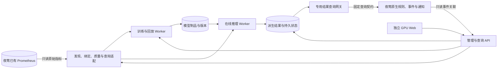

# GPU 机器学习监控模块技术方案

> 实现进展（2026-11-11）：GPU专项独立服务、Web、训练/模型管理及夜莺闭环已形成可运行预览版。本文保留原设计/计划，实际实现与未准入范围见[实现与验收报告](06-实现与验收报告.md)，操作见[运行指南](05-运行与接入指南.md)。真实H100、生产规模和浏览器视觉验收不因代码完成自动通过。

版本：0.1  
日期：2026-11-11  
状态：设计基线保留；当前实现映射和限制见06号报告  
依据：[需求文档](01-需求文档.md)、[指标与场景映射](04-GPU指标与检测场景映射.md)

## 1. 技术决策

| ADR | 决策 | 理由与约束 |
|---|---|---|
| A01 | 独立 Web、Python 管理 API 与模型 Worker | 复用 Python ML 生态；训练与夜莺规则执行解耦 |
| A02 | 生产原始 Prometheus 默认只读 | 延续既有 GPU 方案，不要求部署新采集或修改现有采集配置 |
| A03 | 原规则留在原目录、原夜莺业务组 | 不复制重写硬件判据；GPU ML 新目录、新受管命名空间 |
| A04 | 正式模型与派生结果独立持久化 | 不需第二套原始时序库，也不因源只读失去历史模型结果 |
| A05 | 首个夜莺对接 PoC 使用专用结果查询网关 | 输出本模块持久检测状态；沿用已有恢复实验思路，无需向原始 Prometheus 写入 |
| A06 | 单活动推理实例起步，CPU 模型优先 | 先验证语义和端到端链路，不把多副本等同于高可用 |
| A07 | 模型分数、持续状态、夜莺事件分别建模 | 分清统计检测、确认/恢复和通知事实源 |
| A08 | 插件化及原生前端改造作为备选 | 当前用户入口为独立系统，不以夜莺前端分支为实施前提 |

A05 是对通用 ML 方案的 GPU 专项细化：通用 Demo 通过 Prometheus 抓取模型输出；但既有 GPU 项目要求原始源只读，且有缺数误恢复实测，因此正式模块优先验证“持久结果 + 专用查询网关”。实验环境仍可用新增模拟服务采集，不将该方式强加给生产。

若现场允许增加模型结果抓取，可选择独立的 `metrics_export` 对接方式，但不是部署前提。每个任务只启用一个业务事件入口。`make-event` 等外部事件接口保留为后续适配候选，当前不把未经实测的接口作为已完成能力。

## 2. 现有资产核查

### 2.1 事实源

| 资产 | 路径 | 使用方式 |
|---|---|---|
| 92 项候选指标台账 | `modules/devices/nvidia-gpu/common/monitoring/catalog/metric-inventory.yaml` | 引用 `metric_id`，登记实际字段绑定，不复制全部台账 |
| 42 项综合输入、45 规则和25视图 | `modules/devices/nvidia-gpu/rules/monitoring/h100-training/catalog.yaml` | 关联规则证据和覆盖；不是已采集 ML 特征清单 |
| 综合模拟运行绑定 | `modules/devices/nvidia-gpu/rules/rules/comprehensive-catalog.json` | 只作实验输入契约参考，不把 SIMULATED 当真实硬件 |
| 硬件保持与解除 | `modules/devices/nvidia-gpu/rules/docs/09-硬件告警保持与解除策略.md`、`modules/devices/nvidia-gpu/rules/lab/recovery_adapter.py` | 参考已测三态和持久机制，提取适用逻辑并新增 GPU ML 测试 |
| 既有夜莺管理适配 | `modules/devices/nvidia-gpu/rules/lab/n9e.py` | 参考固定版本 API；模块另建命名空间和最小权限配置 |
| 通用 ML 原型 | `modules/devices/nvidia-gpu/ml/demo/` | 参考 Prometheus、训练、校准和页面方法，不直接复用已训练模型 |

已有 H100 综合验收为模拟：42 项输入、45 条规则、25 视图、56 个实时场景；生产准入为 false，真实 H100 为 not_run。较早的覆盖台账统计与最新综合库统计属于不同阶段，不将它们累加。

### 2.2 已知恢复问题

现有文档记录固定镜像 `flashcatcloud/nightingale:9.3.0` 的 Prometheus 直连路径：配置 `NotRecoverWhenNoData` 并回读成功后，移除字段仍发生恢复。不能再次只根据配置名称宣称支持缺数保持。

已有持久状态适配器是实验验证，不是可直接不经检查用于生产的完整组件。新模块须验证自己的结果、网关、夜莺事件与重启生命周期，并核实实际镜像构建版本；升级版本后重新探测原生能力。

## 3. 架构与目录

### 3.1 数据与控制链路



原始指标留在现有 Prometheus；训练快照按作业保存来源和时间范围；派生结果保存实际值快照、模型版本、分数、基线、有效性和源时间。这些不是重新建设原始采集或第二套原始指标库。

### 3.2 技术选型

| 层 | 建议 |
|---|---|
| 服务端 | Python 3.12、FastAPI，输入输出模型显式版本化；实施时固定已验证依赖 |
| ML | scikit-learn，首期 Ridge/稳健回归与 Isolation Forest；NumPy 做有界特征 |
| 前端 | React + TypeScript + 时序图表组件，独立构建；具体图表库按带状区间、缺口与事件标记 PoC 确定 |
| 状态与元数据 | SQLite WAL 单活动实例起步，迁移路径到 PostgreSQL；训练/结果写入控制批次与锁等待 |
| 制品与快照 | 持久卷，元数据记录摘要和 schema；规模增加时可换对象存储 |
| 部署 | 独立 Compose 文件、独立卷与镜像，加入已有实验网络但不重建旧服务 |
| 测试 | 模型/时间语义测试、Prometheus 协议测试、真实夜莺事件测试和浏览器测试 |

版本和镜像 digest 在实施阶段锁定；不沿用任意最新版本。若 SQLite 压测不能满足结果与队列写入预算，切换 PostgreSQL，不通过增加多写进程绕过约束。

### 3.3 目录规划

当前实现采用轻量包内文件组织，而非提前拆出大量空子包；职责与原设计保持对应：

```text
modules/devices/nvidia-gpu/ml/
├── backend/gpu_ml/
│   ├── main.py              # API、鉴权、固定结果网关与Web
│   ├── settings.py          # 字段契约与运行设置
│   ├── source.py            # 只读Prometheus、源时间、质量与配额
│   ├── models.py            # 条件基线、森林、MAD及受控注册
│   ├── engine.py            # 异步训练、推理、影子与回放
│   ├── store.py             # 元数据、结果、持久状态与备份
│   ├── nightingale.py       # 受管规则、对账与实际事件
│   ├── simulation.py        # 明确启用的GPU语义模拟
│   └── cli.py               # 同步、实际验收和离线恢复
├── frontend/                # 独立GPU页面、Canvas与交互
├── config/bindings.json     # metric_id/字段/单位/模板
├── deploy/compose.yaml      # 独立容器与状态卷
├── tests/test_core.py       # 单元与契约测试
├── scripts/                 # 运行和管理/重启/平台验收
├── evidence/gpu/            # 本次GPU验收
├── docs/                    # 需求、设计、计划、运行、验收
└── demo/                    # 保留的旧通用原型，不充当GPU实现
```

规则资产在 `modules/devices/nvidia-gpu/rules/`，共用指标在 `modules/devices/nvidia-gpu/common/`，只引用与按版本验证；无规则内容覆盖。第一版前端选择原生JS/Canvas而非React，以减少离线预览依赖，API保留独立性。未来按维护需要拆分包，不以生成空目录视作交付。

## 4. 指标接入与质量

### 4.1 绑定和身份

维护“规范 metric_id → 实际指标名/表达式/单位/实体标签”的绑定。每条绑定注明候选来源、观察样本时间、兼容性和批准状态。

物理 GPU 主键为 `source_id + cluster_id + GPU UUID`；界面设备号和主机名不是稳定替代键。MIG 实例在首版标记不支持，不混入物理卡；NVSwitch 使用独立 switch_id，链路使用端口和对端身份，不伪造 GPU UUID。

来源固定 cluster_id 可以由数据源配置赋予，但不能在没有该标签的原始指标上强加选择器导致误判缺数。UUID 缺失或重复时进入绑定待核实，不静默使用 GPU 序号合并。

### 4.2 只读查询

发现阶段使用受限指标元信息和有界查询，避免高频全库扫描；在线阶段按模板批量拉取多个实体，再按稳定键拆分，避免每卡每指标重复扫描。

`query_range` 产生的求值点不必然是新采样。取得相应的源时间信息并对齐，旧样本去重；无法可靠核对源时间的输入不宣称完成新鲜度验证。训练与在线共用查询口径、步长、别名和质量处理。

每源设置查询窗口、返回序列、点数、超时、并发和缓存预算。迟到数据通过明确水位处理；已结束在线时点不静默被后到数据重写。

### 4.3 质量管道

处理顺序：身份/支持范围 → 唯一性 → 源时间 → 非有限值与 sentinel → 值域/单位 → 计数器分段 → 同桶对齐 → 有效输入比例与窗口检查。

- 0 是合法数值时不得当缺失；sentinel 由字段契约判断，不采用任意巨大值作为有效温度或计数。
- 缺失与错误不补零；短插补仅对允许的连续量执行，结果携带质量标记；训练与推理策略一致。
- 长缺口取消尚未完成的 pending；未知期间保持已确认异常，不新增正常确认。
- Counter 重置分段处理，旧新时长字段二选一并统一秒制；Profiling 速率不重复 rate。
- 当前源历史只有 3 天时，预检拒绝不可满足的 14 天训练或要求用户显式缩短范围，不伪称有足够数据。

## 5. 检测策略与模型

### 5.1 模板分层

首期定义 `gpu_ml.thermal_residual.v1`、`gpu_ml.power_clock_relation.v1`、`gpu_ml.activity_change.v1`；可比组检测在具备正确组配置后加入；稀疏互联计数趋势后续验证。

每模板包含适用硬件/实体、必需/可选指标、采样约束、最小有效窗口、特征、模型、分数方向、训练与恢复策略、展示能力和缺数行为。不是发现一个字段就默认适用所有 GPU。

### 5.2 GPU 基线与特征

GPU 训练负载常由任务阶段而非日历周期决定，不把通用 Demo 的 120/360 秒周期带入生产。第一版先用稳健历史基线作对照，再用带负载与滞后特征的 Ridge 或稳健回归估计目标变化；观察到稳定周期后才启用周期特征。

可用特征：GPU/HBM 温度、相对设备运行门槛的余量、功耗/功率上限比例、SM/显存时钟、GPU/控制器利用率、显存使用量、后向均值/方差/差分与趋势；仅在输入存在且口径核实时使用。当前外生负载可用于同刻条件异常分析，但不能冒充提前预测；预测下一步时只用当时已知信息。

联合森林检测多个标准化残差与关系；单指标森林补足单维偏离被高维稀释的问题。森林各分量分别校准，再校准组合分数；不得对不同原始分数直接求均值。

XID/SXid 和枚举按字典/事件解释，不按连续大小学习；ECC 等严重故障信号不能被森林判为正常后屏蔽。规则事件可用于解释和训练窗口筛选，但不是绝对真实标签。

### 5.3 解释与降级

展示实际偏差、参考范围、贡献候选指标和模型版本；“最大标准化残差”明确标为偏差解释，不称精确因果归因。

缺少可选指标可以切换经过验证的独立降级模板，形成新的版本记录；缺少必需输入标记不可评估，不在运行中随意删掉特征继续调用旧模型。新设备历史不足展示冷启动；未经验证不直接借用其他卡的模型。

## 6. 训练与模型管理

### 6.1 支持方式

- 内置算法：按任务历史训练和校准。
- 已发布模型：校验输入结构、单位、步长、实体范围与工况后复用。
- 新模型版本：训练、回放、影子和灰度，不替换失败前的有效版本。
- 自定义适配：先支持受控 Python 模型协议；HTTP/ONNX等格式按实际需求另设协议和测试，不宣称首期全部支持。

协议：`fit(dataset, config)`、`calibrate(artifact, validation)`、`predict(artifact, causal_window)`。结果含 source_time、score、validity、版本和按能力提供的 expected/lower/upper。模型文件、预处理、特征和校准是一个不可分割的发布单元。

### 6.2 流程与状态

`draft → data_check → training → calibrated → validated → shadow → published → retired`；任务执行状态与模型版本状态分开。训练使用独立作业记录与取消信号，不占用在线推理租约。

数据快照保存源 ID、查询版本、源时间范围、有效性比例、实体清单、内容摘要及模拟/真实标志。按时间切分训练、校准和最终测试，清除切分间重叠窗口泄漏；故障与维护窗口按证据排除，训练模式变化单独分析。

评估以事件准确率/召回、检测延迟、每 GPU 或每设备组误报事件数、相对规则增益和资源成本为主。没有真实标签时仅报告已标注子集与未确认数量，不能凭无监督分数声称准确率。

### 6.3 发布与回滚

发布切换模型版本不改变 detector_id；先保存待发布版本和回放证据，再原子切换活动指针。重启从制品摘要、特征配置和源水位恢复，失败保留旧版。回滚形成新审计记录，不删除历史结果或将活跃异常自动恢复。

## 7. 告警与夜莺集成

### 7.1 首选结果网关

新模块不重复开发通知引擎。管理适配器在专用 GPU ML 业务组创建受管规则/数据源，绑定测试通知后验收；普通 GPU 规则留在原业务组并行运行。

结果网关提供实现时明确列出的 Prometheus 查询子集，供夜莺固定表达式使用，例如以下逻辑形式：

```promql
gpu_ml_incident_active{detector_id="..."} == 1
```

实际支持的选择器、连接探测、错误码和响应 schema 在契约测试中锁定；不是通用 PromQL 引擎，也不通过字符串拼接任意代理查询。`query_range`、指标发现等若用于页面连接校验，需明确支持或拒绝，不能伪装完整 Prometheus。

网关返回持久确认状态，未知时不撤回已活动实体。网关自身和存储失效应返回明确错误而非成功空数组；夜莺对 HTTP错误、超时、重启和空结果的差异必须端到端验证。未验证不得启用真实业务通知。

### 7.2 三层状态

| 状态层 | 内容 | 负责人 |
|---|---|---|
| 检测结果 | 分数、阈值、有效性、源时间 | 模型 Worker |
| 持久检测状态 | pending、active、recovering、unknown；最后确认与行政原因 | 模块生命周期组件 |
| 告警事件与投递 | 夜莺活动/历史事件、通知、屏蔽 | 夜莺 |

`unknown` 是质量维度，可与已有 active 同时存在；无有效正常证据不解除。持续确认不能跨缺口拼接；去重依据源时间与实体，不依据 Worker 周期次数。模型和夜莺只保留一层主要持续确认，避免双重等待；网关事件规则的额外 for 只在实际验证需要时配置。

故障暂停、删除、模型替换与设备退役为行政原因，不能发送“GPU硬件恢复”。ML 正常仅解除对应 ML 检测，不解除原硬件规则。

### 7.3 受管对象与事件关联

新对象使用 `managed_by=gpu-monitoring-ml` 和独立任务/版本注释。保存 detector_id ↔ 夜莺 rule_id/datasource_id/group_id 映射；名称不作唯一身份。创建、重试与升级幂等；同名非受管对象或人工改动冲突时停止覆盖并显示差异。

稳定事件标签不包含分数、quality、任意模型版本 UUID 或解释文本，避免一次异常反复结束重建。夜莺事件的活动 ID 与恢复历史 ID 可以不同，关联使用经实测的 hash、原触发时间和规则/实体键。

页面的检测 episode_id 是本地结果关联，不冒充夜莺 event_id。夜莺不可达时显示本地检测状态和事件同步状态，不能把未进入夜莺的结果标成已通知。规则与 ML 命中可关联展示，不自动合并或删除原事件。

### 7.4 其他路径

若现场允许模型结果抓取，输出 `gpu_ml_*` 指标并通过普通 PromQL 创建规则，但必须解决默认空结果恢复与源新鲜度门禁，不能只加 freshness 过滤。严格恢复要求仍优先走已验证的持久结果路径。

`/v1/n9e/make-event` 需要外部规则处理器等适配，列为后续候选；不自动开启 APIForService。任何路径切换都先禁用原事件入口并保留事件关联，避免双重告警。

## 8. 数据模型与接口

### 8.1 核心记录

| 对象 | 主要字段 |
|---|---|
| datasource_binding | source_id、cluster_id、地址/凭据引用、查询预算、时间与标签口径 |
| entity / metric_binding | 稳定实体、类型、身份来源、metric_id、实际字段、单位、质量规则、能力状态 |
| detector / revision | 稳定任务、模板、配置版本、适用实体、模式、阈值/恢复、enabled |
| training_job / snapshot | 时间范围、实体、数据来源类型、进度、摘要、失败与评估报告 |
| model_version | 算法、输入schema、特征/预处理、制品摘要、校准、发布状态 |
| detection_result | 实体、任务、源时间、模型版本、值快照、基线、分数、有效性、计算时间 |
| incident_state | 主键、确认进度、active、quality、最后有效证据、水位、行政原因 |
| nightingale_binding | 受管业务组/规则/数据源、期望和生效版本、同步错误 |
| event_link / feedback / audit | 本地episode、夜莺hash/事件/触发时间、反馈与变更审计 |

结果唯一键至少包含 detector_id + entity_key + source_time + model_version，幂等写入。原始结果与回放结果分表或显式 run_type 隔离；保留策略和索引按实际写量确定。

### 8.2 拟开发 API

统一前缀 `/api/gpu-ml/v1`，以下是自研接口设计而非夜莺原生接口：

| 接口 | 用途 |
|---|---|
| `GET /entities`、`GET /coverage` | 实体、字段质量及规则/ML覆盖 |
| `GET /series` | 同源原始指标与派生结果，对齐时间范围 |
| `GET/POST /detectors`、`PATCH /detectors/{id}` | 任务管理，使用revision/If-Match |
| `POST /detectors/{id}/validate` | 数据和特征预检 |
| `POST /training-jobs`、`GET /training-jobs/{id}` | 异步训练与状态 |
| `POST /training-jobs/{id}/cancel` | 有界取消，不中断已发布模型 |
| `GET /models`、`POST /models/{id}/publish`、`POST /models/{id}/rollback` | 版本与发布 |
| `POST /replays`、`GET /replays/{id}` | 历史回放及报告 |
| `GET /incidents`、`POST /feedback` | 模型事件与反馈 |
| `GET /integrations/nightingale/status` | 对象同步与夜莺事件关联 |
| `GET /health`、`GET /ready` | 存活和依赖/任务就绪，部分降级明确列出 |

所有查询受预算和权限控制；路径中的entity/任务ID不能绕过源权限。训练、发布与规则同步是跨组件流程，使用持久作业和对账，不宣称跨夜莺事务原子性。

## 9. 页面与可视化

独立入口包含：GPU 总览、单卡详情、规则事件、智能任务、训练/回放、模型版本、覆盖与平台健康。默认按 cluster_id、UUID、时间范围联动。

GPU 总览分别显示硬规则事件、ML episode、输入质量和覆盖，不能把没有模型/没有数据画成绿色健康。单卡详情同屏显示温度/功耗/时钟/利用率、模型参考带、分数阈值、真实夜莺事件及版本。

同一时间范围下原始指标从现有 Prometheus 查询，派生结果从本模块结果库读取；统一源时间和显示时区。迟到、缺口、回放和历史模型版本均明确标注，不重新评分后无提示覆盖在线历史。

已有规则先只读集成和跳转，不在新页面增加不受旧规则生命周期控制的编辑入口。受管 ML 任务在本系统编辑；夜莺端外部手工修改作为同步冲突显示。

## 10. 部署与可靠性

首期一个管理/API服务、一个活动推理/结果组件和一个可异步训练执行器，可共用单机但隔离执行资源；所有状态卷独立于旧实验。训练不用生产GPU，不自动执行驱动更新、诊断、重启或设备隔离。

部署只引用现有 Prometheus 与夜莺地址；缺少连接时不启动第二套默认源或静默切回模拟。模块自己的模拟器仅在显式 simulation profile 开启，独立job/cluster标记，避免和旧综合模拟器抢占场景控制。

持久状态包含确认进度和最后源时间。长停机不能当连续成立，pending 依规定重建；active 在未知期间保持但明确最后证据时间。网关与推理职责可分离，推理停滞不影响网关读取已有活动状态；网关或存储故障由独立平台规则监控。

记录查询点数/耗时、数据新鲜度、训练与推理耗时、结果队列/锁等待、模型版本、规则同步、网关错误与通知健康。生产容量按设备数、步长、特征和保留期测量；不把2秒实验采样作为正式默认。

## 11. 验证与风险

| 风险 | 对策与门禁 |
|---|---|
| 实际GPU字段少于候选台账 | 能力发现先行，缺必需输入不开任务；不强制部署新采集 |
| 历史不足 | 训练预检与冷启动状态；长历史快照/保留变更另行安排 |
| 负载变化误报 | 条件基线、同工况分组、空闲/训练反例和影子评估 |
| 仅模拟成功 | 模拟、回放、真实旁路、生产准入分别记录 |
| 缺数导致夜莺误恢复 | 持久结果网关PoC、断网/停机/重启测试；失败阻止通知上线 |
| 模型版本改变事件身份 | 稳定detector/entity键，版本放结果与注释，显式迁移测试 |
| 影响旧规则 | 新namespace和部署，原规则读配置/事件对照，不做全量覆盖导入 |
| 查询与结果存储过载 | 批量查询、限额、回放异步、保留与索引压测 |

门禁与工作分解见[项目计划](03-项目计划.md)。参考既有[GPU架构](../../rules/docs/02-技术架构文档.md)、[综合验收](../../rules/docs/10-H100综合规则与模拟验收.md)、[恢复实测](../../rules/docs/09-硬件告警保持与解除策略.md)、[通用ML调研](<../reports/夜莺 机器学习 自定义模型 调研.md>)。本文不新增对实际驱动、DCGM和Exporter版本的断言，沿用旧研究出处但生产接入须重新核对。
