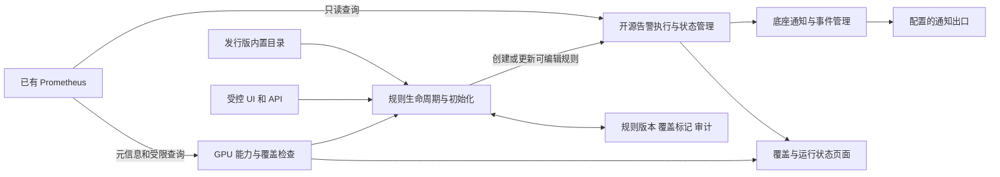

# 独立 GPU 告警系统技术架构

**规范入口：**[第14篇GPU生产主清单](14-GPU监控指标与告警规则说明表.md)是本模块指标、规则语义、适用性及取舍的唯一规范基线。本文在主清单范围内解释需求、实现或操作；旧阶段结论不覆盖主清单。当前代码/台账/证据仅说明实际实现，不能因规范补齐而追认已上线；存在差异按主清单附录C登记。

2026-11-13方案更新：检测职责按[第16篇双通道方案](16-XID事件与指标状态双通道监控方案.md)执行：XID/SXID作为错误事件入口，指标状态规则独立检测，质量/平台规则保障覆盖。当前最近码观测不等于完整事件流；完整事件采集待补齐。**跨规则事件关联和通知收敛按用户要求暂缓，本期不开发或上线**；既有单规则状态及通知机制保持。第14篇已逐项标注角色和XID重叠关系。下文历史阶段状态不覆盖这一最新范围。

版本：0.3  
日期：2026-11-05  
依据：[需求](01-需求文档.md)、[调研报告](<../reports/GPU 告警系统选型与设计.md>)

GPU 规则收集、筛选与验证按[GPU 监控规则库建设方案](04-GPU监控规则库建设方案.md)执行。

2026-11-11进展：本轮候选卡、夜莺综合导入、互联及平台故障模拟验收见[综合规则与验收](10-H100综合规则与模拟验收.md)，逐条状态以其机器可读报告为准。范围为42项输入、45条规则和25个诊断视图；真实H100与生产发行版门禁继续单列。

## 1. 决策与证据边界

采用“完整开源告警平台 + GPU 产品扩展”的设计。开源底座负责查询调度、表达式执行、告警状态、通知与基础管理；产品扩展负责内置 GPU 目录、自动初始化、能力覆盖及内置规则升级保护。取消自研 IR、Go 代码生成和规则编译运行时的前提。

**当前方案确定采用夜莺（Nightingale）作为告警底座，交付“夜莺 + GPU 产品扩展 + 内置规则目录”的完整发行版。** 不再把夜莺与 Grafana 双平台选型作为前置任务；后续原型用于锁定夜莺 release、验证接口和扩展边界。只有明确阻塞验收且补足成本不可接受时，才记录证据并重新评审底座。

夜莺负责通用规则执行、告警状态、通知和基础管理；我们负责 GPU 判断依据、内置规则验证、自动配置、覆盖检查和升级保护。**系统内部仍以规则表达 GPU 检测逻辑，但部署者无需编写、导入或逐条启用规则。** 规则维护由发行版维护者承担；用户只在需要定制时通过 UI/API 修改。

夜莺官方仓库采用 Apache-2.0，允许商业使用、修改和再分发，不要求公开自有扩展或修改源码。发行版应保留许可证及相关版权声明、标明修改，并按要求保留上游 NOTICE（如有）；商标不包含在许可授权中。依赖、前端、规则与镜像组件逐项记录许可，不将主仓库许可直接套用于所有组件。见[官方 LICENSE](https://github.com/ccfos/nightingale/blob/main/LICENSE)。

已部署固定夜莺9.3.0实验环境，并验证API导入、持久状态和本地通知链路；真实硬件与完整产品生命周期仍需P1/P2门禁验收。夜莺原生模板需导入且默认停用，不能原样作为产品交付；产品须自动创建并启用满足条件的实际规则。见[夜莺模板](https://n9e.io/zh/docs/alerting/templates)。本节决策更新了调研报告中的“优先候选”状态，调研报告保留为历史依据。

首版规则目录只面向H100。型号配置、指标可用性和规则参数适用性分别记录，硬件准入不得只依赖modelName字符串。具体形态/版本未核实或MIG粒度未准入时，不自动启用对应规则；H200等型号不继承H100配置。参见[H100范围](../../common/monitoring/hardware/H100.md)。

## 2. 总体结构与职责

Prometheus 只提供查询，不接收规则配置、写入或新增采集；不部署第二套 DCGM 或重复指标库。能力检查不另写告警执行器；它把适用性和数据质量结果接入底座执行或产品状态展示。底座的通知、调度与状态机只保留一套。

基线每集群独立安装同一发行版，集群故障域与数据库隔离。集中多数据源部署为可选：每源独立凭据、cluster_id、超时和限额，不因一个源故障阻塞其他源。当前不开发跨独立实例的集中规则下发服务。

## 3. 交付与最小拓扑

提供固定版本镜像、Compose 或 Helm 安装入口、数据库迁移、备份恢复和升级说明。使用者填连接、通知、身份及持久化参数，不接触规则文件或模板导入。

| 组件 | 职责与交付要求 |
| --- | --- |
| 夜莺固定版本 | 唯一规则执行、告警状态与通知底座；复用原生查询、静默、路由和基础权限 |
| GPU 产品扩展 | 内置目录、适用性发现、自动初始化、覆盖展示、规则版本与审计、升级保护 |
| 持久元数据库、Redis | 随部署配置交付；具体兼容版本、用途和持久化要求按夜莺固定 release 验证 |
| 已有 Prometheus | 只读查询；不新增 DCGM、示例采集器或第二套指标库 |

夜莺文档区分元数据与时序库，[HA 文档](https://n9e.github.io/zh/docs/install/high-availability)列出 MySQL、Redis 等依赖；交付不是一个无依赖容器。P1 输出最小可运行拓扑、健康检查、卷与备份清单，不直接照搬包含采集器和指标库的示例栈。

MVP 单活动执行实例，数据库/Redis/通知等均需持久化与监控。HA 后续复用底座官方方式，验证规则分片、重复评估和通知去重；不通过增加副本数直接宣称高可用。

## 4. 规则事实源与写入边界

优先在底座规则事务层扩展目录身份、不可变 revision、override/tombstone 和审计，复用原生 UI/API。**所有写路径，包括 UI、API、初始化和升级，必须经过同一个生命周期服务。** 夜莺只记录最后修改不足以满足历史回滚；若无法用受支持扩展保证，应评估小范围维护分支成本。P1 必须明确扩展点和维护差异；若成本过高则提交阻塞证据重新评审，不能让原生 UI 绕过版本控制。

如果原型选择外部产品数据库，产品库是受管 GPU 规则期望状态的唯一事实源；底座规则是执行投影，受管命名空间禁止直接写入。产品提供其规则 UI/API，底座原生页面只读查看受管对象。不能同时允许两边任意编辑并用轮询宣称完整审计。底座自身告警状态、通知记录仍由底座持有，产品不复制为第二套状态机。

跨数据库或 HTTP API 没有同一事务：先在产品库事务保存 revision、审计和待应用操作，再幂等调用底座并回读验证，最后标记 active_revision。公开 desired_revision、active_revision、apply_state、last_apply_error。失败时保留旧版本是待原型证明的产品要求，不能当作底座 API 原生保证。HTTP 超时可能已经应用，先标记结果未知并回读核对底座内容与 revision；禁止盲目重试覆盖。确认后再重试或显式补偿，进程崩溃后扫描未完成操作。单条可验证激活是最低承诺，批量更新逐条显示状态，不假定组原子切换。

### 4.1 P1 写入边界决策

当前优先方案是在夜莺规则写事务层增加生命周期扩展，复用原生规则 UI/API；初始化、在线编辑和升级均调用该入口。扩展与上游变更分开记录，固定版本维护补丁及升级验证清单。

若固定版本无法以可控改动覆盖全部写路径，才采用前述外部产品库与单向投影方案，并补齐受管规则编辑界面。P1 结束前必须选定其中一种，形成 ADR；P2 不同时实现两套管理方案。两种实现都保持夜莺为唯一告警执行底座。

## 5. 规则模型与内置目录升级

| 对象 | 关键字段 |
| --- | --- |
| BuiltinCatalog | catalog_version、签名/摘要、rule_key、来源版本/许可、适用条件、指标依赖、默认规则内容 |
| RuleRevision | 稳定 rule_id、revision、base_catalog_revision、完整内容、hash、actor/time、变更原因 |
| LocalDecision | override、enabled、deleted tombstone、upstream_removed、冲突状态 |
| RuleApplication | datasource_id、desired/active_revision、底座对象 ID、操作 ID、应用时间和错误 |
| Coverage | cluster/device/rule、输入能力、数据新鲜度、状态及原因 |
| AuditEvent | 操作者、动作、前后 revision、对象、结果、请求 ID；不含密钥 |

首次启动在初始化锁下校验数据源和通知，发现 GPU/指标，按稳定 rule_key 幂等创建数据库对象，自动绑定数据源与通知，启用适用规则。正常新装不是“把模板库装好等待用户导入”。身份、摘要与操作 ID 保证重启和并发启动不重复；尚无指标时展示等待状态，后来发现数据再协调适用性。

后续启动协调已保存状态，不按出厂目录全量覆盖。升级用旧基线、本地有效内容、新基线做三方比较：未改规则更新；本地修改保留并产生待解决差异；自定义规则不动；禁用和 tombstone 保留。上游删除按需求退役或标记复核。恢复默认显式清除覆盖和删除标记；回滚生成新 revision，并重新检查当前数据源与语法兼容性。应用和数据库 schema、系统二进制回滚分别设计；升级前做备份。

目录由维护者随发行版发布，线上普通规则修改独立保存，二者分开版本。正常修改无需重建镜像，平台 API 变更需经过适配器兼容验证。

## 6. CRUD 与应用协议

逻辑 API 包括规则分页搜索、详情/版本/差异、草稿创建/复制、校验/预览、更新发布、启停、软删除、回滚和恢复默认。路径和鉴权复用所选平台，不提前编造已经存在的自定义接口。请求携带 expected_revision/ETag，过期返回冲突。viewer、operator、admin 对规则和数据源操作分别授权。

检查顺序为权限 → 原生表达式语法 → 指标/单位/身份 → 查询预算 → 限流预览 → 生成 revision → 应用确认。预览显示命中实体及观测值，不发告警；没有指标时不伪装预览通过。引擎不支持的表达式明确拒绝，不转换成近似语义。

规则修改前保持旧版本运行；成功激活后切换。表达式、身份标签、窗口/持续条件改变，旧实例以 rule_changed 结束，新版本重新评估；纯描述修改是否保留状态在底座原型确认后固定。禁用/删除清理 pending、结束活动实例并抑制旧重复消息，历史不删除，通知注明行政原因。不能把底座自动发出的普通 resolved 文案直接当硬件恢复，需要适配或选择能区分的路由。

## 7. GPU 能力、数据质量与规则准入

指标映射按固定 Exporter/DCGM 版本及真实样本建立，核对 gauge/counter、单位和 sentinel。可用字段随硬件与配置变化；[NVIDIA 指标文档](https://docs.nvidia.com/datacenter/dcgm/latest/reference/dcgm-exporter-metrics.html)说明采集字段和 MIG 标签，[特殊值定义](https://docs.nvidia.com/datacenter/dcgm/latest/dcgm-api/dcgm-api-enums.html)定义无效值。INT64 sentinel 经 float64 后不保证能区分具体错误原因，但必须识别为无效数据。

实体以 cluster_id + UUID + 必要 MIG 标识为键，pod/容器变动不产生新的硬件身份。维持已发现设备的时间记录，以判断部分设备消失；首次无数据只显示未发现，不虚构设备总量。设备更换与 MIG 重建执行独立生命周期。

首批候选是有依据且有输入的 ECC、行重映射、型号相关 XID、温度余量/热降频及采集覆盖检查。候选不是已经启用的正式规则集。XID 码与计数器不同，不能使用 increase 统计错误次数；设备利用率/占用率不默认当故障。来源、许可、硬件范围、表达式、持续/恢复条件、缺数行为、样例期望均齐全后才准入。

覆盖状态与告警状态分离。查询错误、陈旧、sentinel、缺数不得被正常恢复掩盖。底座整查询 No Data 机制不能代替单卡消失检测。将这些用例纳入真实底座测试，而非另造简化状态机。

## 8. 可靠性、安全与验收

规则和审计持久化不代表 pending、firing、通知队列已持久化。固定版本必须实测中途重启、长时间停机、数据源失败、通知断网和规则更新。明确原生状态恢复、重建或计时重置契约；不推断停机期间条件一直成立。不满足验收就补有界能力或改选底座，不承诺无缝等价。

复用平台通知分组、静默、路由和重试，观察发送失败与积压，事件带稳定关联键和规则版本。不声称端到端恰好一次；队列崩溃恢复及旧通知抑制须验证。若配置外部 Alertmanager，它只是通知组件，不承担指标判断。

每源配置独立认证引用、TLS、超时、并发、窗口上限和序列预算；预览与后台执行共享限额。限制 UI/API 写权限，避免暴露底座内部管理口，日志脱敏。能力检查和后台评估统计查询开销，避免全指标高频扫描。

健康表示进程存活；就绪要求库可用、初始化完成、必要对象应用成功。数据源不可达显示降级/未就绪，具体运行策略在原型固定；部分规则缺输入不阻止已有覆盖运行。公开目录版本、有效规则版本、覆盖、最近评估及错误。实现尚未开始，容量、HA、通知协议、平台 release 与正式内置数量待验证。

## 硬件告警保持与解除实验进展（2026-11-09）

已验证当前夜莺9.3.0 Prometheus直连路径的无数据恢复配置未生效，不能仅靠配置项认定支持。隔离实验新增只读持久状态适配器和独立Docker卷，夜莺继续承担活动事件、历史及通知；两条硬件规则在缺数/无效/陈旧/重复/采集失败时保持活动，有效唯一新鲜标志0才解除。未修改既有Prometheus采集或夜莺源码。

[设计与验证方法](09-硬件告警保持与解除策略.md)、[验收结果](../monitoring/tests/hardware-lifecycle-results.yaml)记录9个状态用例、上游查询失败、适配器和夜莺真实重启均通过。新增12个解除判据用例，离线累计79用例/447断言；单元/HTTP测试25项通过。

该适配器属于实验架构增量，未批准生产准入。继续优先评估可验证的原生恢复路径替代可能性；若保留组件，须完成真实库存/维护、备份迁移容量、行政关闭/CRUD、权限、评估通知健康与故障预算门禁。其余H100指标规则卡仍按覆盖矩阵推进，不将本实验视作全面覆盖或真实H100通过。
