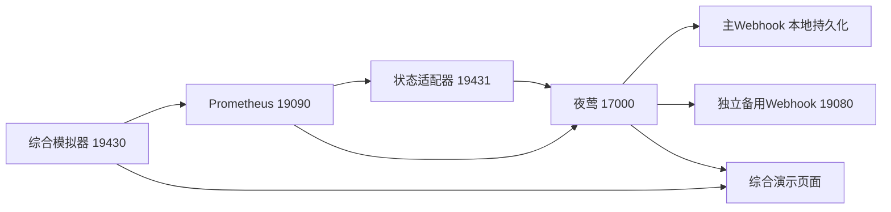

# H100综合规则、验收与演示

**规范入口：**[第14篇GPU生产主清单](14-GPU监控指标与告警规则说明表.md)是本模块指标、规则语义、适用性及取舍的唯一规范基线。本文保留当时的设计/验收事实，不作为当前准入依据。当前代码/台账/证据仅说明实际实现，不能因规范补齐而追认已上线；存在差异按主清单附录C登记。

日期：2026-11-11。范围：H100物理GPU训练、无虚拟化，在无GPU主机上用Docker Compose完成候选规则的端到端验证。最终结果以[机器可读验收记录](../monitoring/h100-training/acceptance-results.yaml)为准。

## 本轮三项交付

1. 将诊断判据完善为输入契约、规则卡和处置说明：42项输入、40条硬件/质量候选规则、5条平台健康规则，以及25个只读诊断视图。逐条包含字段ID、单位、类型、对象身份、必要输入、有效范围、触发/解除、严重度、持续时间、PromQL、参数、来源和测试状态。入口为[候选库](../monitoring/h100-training/README.md)。
2. 将实验副本幂等导入夜莺9.3.0的“H100训练综合演示”业务组，通过真实Prometheus求值、实际夜莺事件和本地Webhook通知验证触发与退出。规则导入发现同名规则被本地编辑时停止，避免覆盖。
3. 补齐预期GPU/交换机端口掉线、PCIe负载下退化、NVSwitch温度/SXid/端口错误、Fabric Manager状态与能力，以及查询/评估/通知和组件健康。不同实体分别使用UUID、switch_id和link_id，交换机不伪造GPU UUID。

本轮验收不代表所有H100故障可观测，也不代表生产发行版已经完成。[24项目标映射](../monitoring/h100-training/coverage-map.md)逐项说明已实现内容和剩余边界。

## 环境与数据链路



所有服务都由[Compose](../../../../../deploy/nvidia-gpu/lab/compose.yaml)管理。综合模拟器和状态适配器使用独立命名卷，保留通知尝试、已确认状态与持续确认进度。API Token只在服务端以只读文件挂载，页面不返回密钥。旧模拟规则及其数据单独保留。

夜莺自监控指标经综合服务的`/nightingale/metrics`转发，正文直接来自夜莺`/metrics`，便于在夜莺正常运行时注入指标抓取HTTP503。另一个看门狗直接检测夜莺、Prometheus、状态适配器，并在页面显示可达性。看门狗不等于生产外部HA监控。

夜莺仍负责规则调度、事件和通知。实验增加的小型状态适配器负责“缺数保持、有效证据解除”和持续确认，原因是夜莺原生直接查询的恢复行为不能满足已验证的硬件状态保持要求，详见[保持与解除策略](09-硬件告警保持与解除策略.md)。这项组件及其持久化应计入后续生产方案维护成本。

## 关键参数和语义

| 参数或行为 | 本次演示 | 生产候选与边界 |
| --- | --- | --- |
| 采样/状态轮询/夜莺评估 | 2秒 / 2秒 / 5秒 | 现场容量与延迟预算另验收 |
| 原始样本新鲜度 | 0—15秒 | 90秒候选，结合实际采样周期审定 |
| 近期计数活动窗口 | 30秒 | 300秒候选，需现场基线 |
| 硬件持续状态 | 通常10秒；计数活动5秒；锁存事件0秒 | 每条规则卡单列，不能作为NVIDIA官方统一参数 |
| 温度 | 读取模拟设备运行门槛；恢复余量大于5°C | 门槛读取实际设备，回差是工程提案 |
| 无输入/非法值/查询错误 | 不生成健康结论，保持已确认硬件异常 | 数据质量或组件健康另行告警 |
| 持续确认中途缺数 | 取消尚未完成的确认；再次有效后重新计时 | 确认间隔超过6秒也重新计时 |
| XID/SXid解除 | 有效码0且恢复复核输入为1 | 原始last-XID不是完整有序事件流；真实恢复动作另接入 |
| 端口掉线 | 只有预期启用的端口参与 | 未使用端口不报警，预期清单来自实际拓扑 |
| 适配器故障 | 单独平台告警，抑制派生的逐规则查询错误 | 原硬件事件保持；组件重启不清空状态 |
| 通知故障 | 主通道实际返回503，备用本地通道报警 | 生产出口和外部通道需另验收 |

综合库是候选，生产默认禁用；仅实验业务组中的副本启用。所有设备modelName明确为SIMULATED，不把合成数据当作真实H100验证。

## 直接验证与演示

当前环境已部署，无需重新初始化。

打开[综合演示页](http://localhost:19430)，点击“一键演示：高温 → 缺数保持 → 恢复”。页面会自动执行：

1. 确认正常基线，注入GPU高温，等待持续条件及夜莺真实事件。
2. 显示活动事件ID和主通道实际投递。
3. 切换设备观测消失，核对高温事件ID及hash不变，并出现设备观测消失告警。
4. 发送有效恢复证据，等待同一hash关联的恢复记录，展示通过结果。

夜莺活动事件ID和恢复历史记录ID可能不同，关联使用hash与原触发时间；缺数期间活动事件ID不变。

页面还可选择预期链路掉线、Fabric Manager失败、查询失败或通知失败，分别观察活动事件、质量状态及备用投递；“恢复并确认”用于结束演示。点击“查询25个只读诊断视图”可直接查看实际Prometheus求值，空结果须结合输入和查询含义解释。

CLI入口：

```bash
bash modules/devices/nvidia-gpu/rules/scripts/lab.sh comprehensive state
bash modules/devices/nvidia-gpu/rules/scripts/lab.sh comprehensive scenario gpu_thermal
bash modules/devices/nvidia-gpu/rules/scripts/lab.sh comprehensive scenario entity_missing
bash modules/devices/nvidia-gpu/rules/scripts/lab.sh comprehensive scenario recover
bash modules/devices/nvidia-gpu/rules/scripts/lab.sh comprehensive suite --case hardware
bash modules/devices/nvidia-gpu/rules/scripts/lab.sh comprehensive suite --case quality
bash modules/devices/nvidia-gpu/rules/scripts/lab.sh comprehensive suite --case platform
bash modules/devices/nvidia-gpu/rules/scripts/lab.sh comprehensive suite --case semantics
python modules/devices/nvidia-gpu/rules/scripts/test_comprehensive_restart.py
bash modules/devices/nvidia-gpu/rules/scripts/lab.sh test
bash modules/devices/nvidia-gpu/rules/scripts/test_monitoring.sh
python modules/devices/nvidia-gpu/rules/scripts/check_h100_training.py
```

场景测试共用综合模拟输入，必须顺序执行；不要在验收中途切换场景。原始本地结果位于`.local/reports/comprehensive-*.json`；审核后的结果冻结在[验收证据目录](../monitoring/tests/comprehensive)。浏览器演示画面和事件证据见[演示记录](../reports/demos/h100/README.md)。

已有夜莺环境中重启本套服务可执行`bash modules/devices/nvidia-gpu/rules/scripts/lab.sh comprehensive-up`。首次安装需先生成候选文件、保存本地测试Token，再执行一次`bash modules/devices/nvidia-gpu/rules/scripts/lab.sh comprehensive-init`初始化专用状态卷；此命令拒绝覆盖已有数据库。卷丢失或绑定变更会报错，不能通过自动清空数据库恢复。

## 尚需真实环境完成的工作

核实H100形态、MIG状态、驱动/DCGM/Exporter和字段样本、实际链路拓扑；真实训练旁路验证阈值、负载和持续参数；接入有序事件与人工/自动恢复动作证据；完成生产初始化、目录升级/本地覆盖、备份、权限、容量及外部HA监控门禁。C13重映射资源、C15管理状态及C23训练效率仍需现场数据和策略，不填造故障规则。
