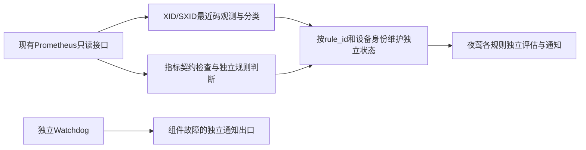

# XID事件与指标状态双通道监控方案

**规范入口：**[第14篇GPU生产主清单](14-GPU监控指标与告警规则说明表.md)是本模块指标、规则语义、适用性及取舍的唯一规范基线。本文在主清单范围内解释需求、实现或操作；旧阶段结论不覆盖主清单。当前代码/台账/证据仅说明实际实现，不能因规范补齐而追认已上线；存在差异按主清单附录C登记。

日期：2026-11-13。状态：方案修订已确认；本轮更新文档，不改变线上规则、启停、严重度、通知绑定或采集配置。本方案在第14篇主清单约束内解释检测职责及后续实施范围；若与其他文档有差异，统一按第14篇审定，不另立优先级。逐项清单见[第14篇说明表](14-GPU监控指标与告警规则说明表.md)。

指标清单现按8个监控对象域组织，详见[分类与覆盖核查](../reports/GPU监控分类与覆盖核查.md)。分类与XID/独立指标等检测角色是两个维度；资源容量和计算/显存活动作为建议观测补充，不因本次文档整理而新增在线规则。

## 1. 监控原则

GPU错误事件以XID为主要入口；GPU当前状态、持续劣化和监控覆盖通过指标规则独立检测。两类检测互补，指标规则不以“已有XID”为前置条件，也不因“没有XID”判定健康。NVSwitch错误使用适用硬件的SXID通道，不与GPU XID混用。

“主要/辅助”描述证据角色，不代表固定严重度排序或触发依赖。XID不是根因诊断；非零代码不统一认定为硬件损坏，也不统一升级为严重告警。持续过热等指标告警可以比某些仅需记录的XID更紧急。码义、型号/驱动适用性、官方处置建议和项目运行策略分别记录。

本期不实现跨规则事件关联、故障合并、跨规则通知去重、主次告警选择或相互抑制。每条规则仍独立确认、保持、恢复，并按已有夜莺策略通知。多条规则可能报告同一故障，当前明确保留这些信号，不为消除重复而删掉补充检测能力。已有单规则重复通知控制、持续确认、同一事件状态保持继续使用，不把这些能力称为跨规则收敛。

## 2. 检测职责与当前46项规则

| 类别 | 当前规则 | 职责与判定边界 |
|---|---|---|
| XID错误事件检测：5项 | xid_node、xid_reset、xid_app、xid_scope、xid_unknown | 按固定目录分组解释GPU错误码。分组是项目策略，需结合官方型号及处置建议；进程/软件线索不等于硬件坏卡。当前以最近码观测代理事件，不是完整事件采集。 |
| SXID交换机错误检测：2项 | sxid_fatal、sxid_nonfatal | 观察NVSwitch错误通道，按switch_id定位；不是错误次数，不等价于GPU XID。适用范围以当前硬件契约为准。 |
| 指标状态检测：27项 | 内存状态3项、温度3项、时钟原因位7项、近期计数活动8项、预期端口2项、PCIe能力1项、Fabric状态3项 | 独立识别当前状态、持续问题、近期活动或能力缺口。温度取设备门槛；计数窗口和持续时间为工程参数；预期链路/Fabric/PCIe依赖OS清单和实际活动。部分是运行提示，不应解释为硬件故障。 |
| 采集与数据质量：7项 | entity_missing、field_missing、input_stale、input_invalid、input_duplicate、collector_down、identity_missing | 识别无法形成可信健康结论的输入。按采集/设备身份判定，不由XID替代，不把缺数解释为健康。 |
| 监控平台可靠性：5项 | platform_query_failure、platform_evaluation_stall、platform_notify_failure、platform_adapter_down、platform_nightingale_metrics_missing | 识别监控系统自身失效；通知失败counter规则仍因输入覆盖缺口禁用。独立Watchdog补足组件失效监测。 |

以上共46项，不等于46种互不重叠的硬件故障。8项额外ECC指标只用于诊断；网关健康可选规则及独立Watchdog见说明表，不改变当前夜莺组46项的口径。

## 3. 两条检测通道

### 3.1 XID/SXID错误事件通道

目标是保留错误发生时刻、代码及原始证据，再按设备和官方码义做规则判断，不依赖业务作业、租户或调度标签。

当前已实现：从Prometheus读取`DCGM_FI_DEV_XID_ERRORS`及NVSwitch错误字段，通过固定分组形成独立规则状态；原样本时钟、缺数保持、人工恢复确认及审计沿用运行服务实现。

当前缺口：最近错误码不是事件流。两次采样之间出现并被后续代码覆盖的事件可能遗漏；重复相同代码也无法仅靠数值变化完整计次。没有观测到XID不能证明没有发生过错误。当前零码加当前事件恢复确认是现有版本的解除约定，不代表自动证明硬件修复。

后续补齐：选择内核日志/journald或DCGM事件通道作为事件输入，记录原始代码、事件时间、主机身份、可用的GPU UUID/PCI地址、启动标识和采集位置；身份无法可靠映射时显式报告缺口，不猜测归属。处理断线重连、采集位置续读、日志轮转、重启及重复投递。不得把同设备同代码永久去重，否则会丢掉后续真实事件。这一项是事件输入完整性改进，不实现跨规则关联，也不代表已经部署。

XID处置按官方目录和当前型号/驱动适用性复核；保留未知码排查入口。XID 63是重映射事件，不能仅因非零就等同重映射失败；相关代码和字段的语义仍分别判断。官方处置建议是排查/处置依据，本期不新增自动重置、重启、隔离或换卡动作。

### 3.2 指标状态独立检测通道

继续只读查询Prometheus；按job/instance/UUID或switch_id/link_id隔离，先检查契约、有效性、新鲜度及唯一性，再执行各规则的状态判断。

| 指标用途 | 保留原因 | 本期处理 |
|---|---|---|
| ECC增量、SRAM门槛、重映射状态 | 与部分XID有关联，但计数、持续状态和维护标志不是同一种证据 | 保留独立规则，不等待XID；计数窗口退出仅表示近期活动安静 |
| GPU/HBM/NVSwitch温度及热限制 | 可独立识别持续过热和热限制，不保证每次越界都对应一个XID | 设备门槛、确认时间、回差及有效输入要求保持；相关规则暂不相互抑制 |
| NVLink/NVSwitch端口和错误活动 | XID可提供事件线索；端口状态、错误增量仍补充当前链路证据 | 只对预期启用端口判断掉链；相同故障触发多个规则时暂分别记录/通知 |
| 活跃传输期间的PCIe代际/宽度 | 反映链路能力是否低于OS资产预期，不保证有XID | 依赖实际TX/RX活动及每卡基线；空闲不据此新增故障或解除故障 |
| Power Cap、Sync Boost | 可能是正常策略或组约束，不能直接推断坏卡 | 在说明表标为运行状态提示；不在本次偷偷调整线上严重度或通知路由 |
| 未核实时钟位、Fabric能力缺口 | 反映解码/支持范围或配置预期问题 | 标为能力/契约提示，不等同硬件故障 |
| 缺失、陈旧、重复、非法值、平台失效 | 错误事件本身不能保证采集与执行链路正常 | 保留独立监控；无效/缺失输入不解除已有硬件事件 |

## 4. 本期执行链路与暂缓范围

图中是当前执行链路。完整错误事件采集仍待补齐，不能将上图理解成已经订阅内核/DCGM事件流。

跨规则关联和通知收敛明确排除在本期之外，不新增聚合服务、关联窗口、跨规则事件ID、XID优先屏蔽或统一故障恢复机制。同卡同时间的两个信号也不能直接被认定为同一根因。本期不承诺“一张卡一次故障只通知一次”，但不取消已有单规则幂等及重复发送控制。

## 5. 实施顺序与验收边界

| 工作 | 状态 | 验收要求 |
|---|---|---|
| 双通道职责、现有规则角色及XID重叠说明 | 本轮文档已整理 | 第14篇覆盖全部46项规则、37个DCGM字段；保留原六列和来源定位 |
| 当前规则与平台接入 | 已有实现，沿用既有证据 | 原夜莺17000、OS SRE组46项，45启用/1禁用；本轮不重新导入、删规则或改通知 |
| 完整XID/SXID事件输入 | 后续实现，未验收 | 验证短时多事件、重复同码、断线/重连、重启、身份映射和采集缺口；事件不因后续代码变化被静默清除 |
| 指标状态规则 | 已有实现，按说明表独立执行 | 有效指标达到条件且没有XID时仍能触发；缺数/非法值不能当恢复；正常Power Cap不能被文档误写为硬件损坏 |
| 通知级别/处置策略复核 | 文档说明角色，实际配置变更另行实施 | 区分紧急故障、维护关注、运行信息和输入/平台故障；不把“辅助指标”统一降级，也不把所有XID统一升级 |
| 跨规则事件关联、通知收敛 | 用户明确暂缓 | 本期不开发、不上线、不计入本期完成条件 |

本轮没有新增运行测试结果；文档完整性和链接检查不等于完整XID采集验收。已有模拟验收证据继续保持原有范围，不改写成真实GPU验证。

## 6. 依据与适用边界

- [NVIDIA XID Introduction](https://docs.nvidia.com/deploy/xid-errors/latest/introduction.html)：XID是驱动错误报告和排查入口，不直接等价于硬件根因。
- [NVIDIA XID Catalog](https://docs.nvidia.com/deploy/xid-errors/latest/analyzing-xid-catalog.html)：代码、硬件适用性和处置建议；例如重映射事件/失败、NVLink错误需分别解释。
- [AWS EKS节点健康监测](https://docs.aws.amazon.com/eks/latest/userguide/node-health-nma.html)：公开方案同时使用XID和DCGM健康检查，同一次故障可通过两种信号表现。这支撑保留多种检测，不代表本期实现AWS的节点条件或自动修复。
- [NVIDIA NVSentinel GPU Health Monitor](https://docs.nvidia.com/nvsentinel/configuration/gpu-health-monitor/)：采用DCGM健康检查并补充温度余量/Power Brake等字段检测，区分观察记录与处置。本项目借鉴职责划分，不照搬其阈值、支持范围或隔离策略。
- [项目逐规则来源表](../monitoring/os-sre/provenance.md)：当前字段、固定源版本、项目判据和参数来源；[运行手册](../runtime/README.md)及[清理接入记录](15-当前夜莺规则接入与历史清理记录.md)描述实际已部署状态。
